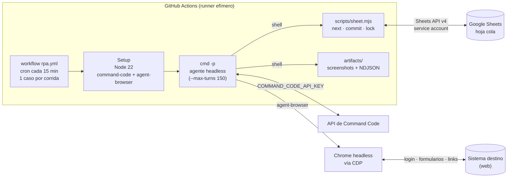
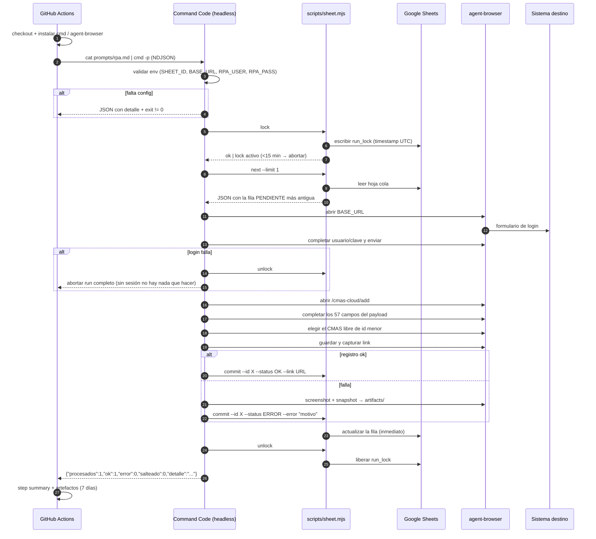
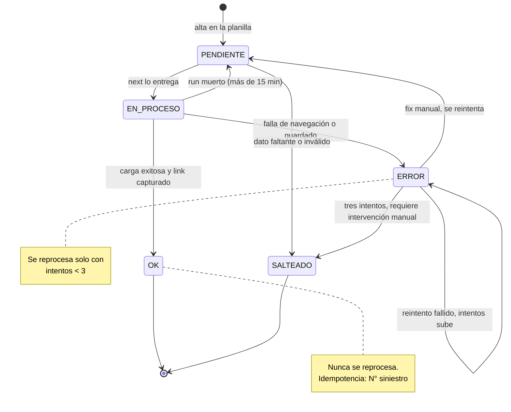

# commandcode-rpa

Agente RPA que corre 100% en la nube (GitHub Actions): lee filas pendientes de una
planilla de Google Sheets, se loguea en un sistema web, carga cada registro,
captura el link y escribe el resultado de vuelta en la planilla.

El cerebro es **Command Code en modo headless** (`cmd -p`) autenticado con
`COMMAND_CODE_API_KEY`; el navegador lo maneja **`agent-browser`** (Chrome vía CDP).
Las reglas del agente están en [`AGENTS.md`](./AGENTS.md) y se cargan solas en
cada run. No depende de tu máquina ni de un servidor propio.

## Índice

- [Cómo funciona](#cómo-funciona)
- [Arquitectura](#arquitectura)
- [Secuencia de un run](#secuencia-de-un-run)
- [Ciclo de vida de una fila](#ciclo-de-vida-de-una-fila)
- [Contrato de la planilla](#contrato-de-la-planilla)
- [Datos de ejemplo](#datos-de-ejemplo-files_examples)
- [Carga de un caso](#carga-de-un-caso-receta-del-formulario)
- [Decisiones de diseño](#decisiones-de-diseño)
- [Estado actual](#estado-actual)
- [Puesta en marcha](#puesta-en-marcha)
- [Operación](#operación)
- [Costos](#costos)
- [Próximos pasos](#próximos-pasos)

## Cómo funciona

La idea central: **el LLM orquesta, los scripts hacen la E/S**.

- Command Code decide el orden de las acciones y resuelve el sitio destino
  (navegar, completar formularios, capturar el link).
- La planilla nunca se lee ni se escribe "desde el modelo": todo pasa por
  `scripts/sheet.mjs`, que habla con la API de Google de forma determinística.
  Así no hay datos inventados ni escrituras a medias.

En una frase: un run de Actions levanta un agente headless, le da una cola de
filas, y el agente deja cada fila resuelta en la planilla antes de tocar la
siguiente.

## Arquitectura



Credenciales: **todas** vienen de GitHub Actions secrets and variables. Nada está
hardcodeado en el repo ni escrito en logs.

## Secuencia de un run



Puntos que hace visible el diagrama:

- **Un caso por corrida.** El cron arranca cada 15 minutos; cada run carga una
  fila y termina. 20 casos = 20 corridas.
- **Commit inmediato.** Si el run se cae después de guardar, la fila ya quedó
  marcada y no se duplica.
- **Login fallido aborta todo.** Registro fallido no.
- **`unlock` siempre**, incluso en el camino de error.

## Ciclo de vida de una fila



## Contrato de la planilla

Una sola hoja (nombre en `SHEET_TAB`, default `Casos`) con las **57 columnas de
carga** (A..BE) y **5 columnas de control** agregadas al final:

| Columna          | Contenido                                              | La escribe |
| ---------------- | ------------------------------------------------------ | ---------- |
| `estado`         | vacío o `PENDIENTE` \| `EN_PROCESO` \| `OK` \| `ERROR` \| `SALTEADO` | ambos |
| `link`           | URL o referencia del registro.                         | agente     |
| `intentos`       | Número de intentos realizados.                         | agente     |
| `actualizado_en` | Timestamp ISO 8601 en UTC.                             | agente     |
| `error`          | Motivo del fallo o del salteo. Vacío si `OK`.          | agente     |

El **id de cada caso es `N° siniestro`** (columna J, único). No hay columna `id`
extra ni `payload` en JSON: los datos están en las 57 columnas de carga.

Reglas de selección:

- Se procesa la fila más antigua con `estado` vacío o `PENDIENTE`.
- Se procesa `ERROR` solo si `intentos < 3`.
- Una fila en `EN_PROCESO` con menos de 15 minutos de antigüedad es de otro run.
- Una fila en `OK` o `SALTEADO` nunca se reprocesa.

### Comandos de la planilla

```bash
node scripts/sheet.mjs init             # crea las columnas de control
node scripts/sheet.mjs status           # conteo por estado + lock
node scripts/sheet.mjs next --limit 1   # caso a procesar (marca EN_PROCESO)
node scripts/sheet.mjs commit --id <N° siniestro> --status OK --link <URL>
node scripts/sheet.mjs commit --id <N° siniestro> --status ERROR --error "<motivo>"
node scripts/sheet.mjs lock             # aborta con exit 3 si hay otro run
node scripts/sheet.mjs unlock
```

`next` sin `--dry-run` escribe `EN_PROCESO` al entregar el caso, así dos corridas
no pueden tomar la misma fila. Si un run muere, la fila vuelve a estar disponible
pasados 15 minutos.

## Datos de ejemplo (`files_examples/`)

Dos archivos, uno por cada lado del flujo:

| Archivo | Rol |
| --- | --- |
| `siniestros-agricolas_2026-11-13.xlsx` | Export real del sistema destino (128 siniestros, 67 columnas). Es la referencia de qué datos existen y con qué forma. |
| `cmas-cloud-casos.xlsx` | Planilla de carga (57 columnas). Hoy contiene **20 registros sintéticos** generados a partir del export. |

### Qué se aprendió del export real

- Compañía `Seguros del Pichincha`, Sucursal `PVO`, Ramo `14`; pólizas `0000000010`
  (USD 1000/ha) y `0000000012` (USD 1200/ha).
- Cobertura y causa únicas: `00 SEQUIA O DEFICIENCIA DE LLUVIA`; cultivo
  `CULTIVO DE MAIZ DURO MANCHENO`; ciclo `INVIERNO 2026`.
- 97% Manabí (Sucre/San Vicente, Tosagua, Rocafuerte, Santa Ana…), lotes de 1-3 ha,
  coordenadas UTM 17S (`X` 550-640 mil, `Y` 9.79-9.92 millones).
- `Rendimiento total (qq) = qq/ha × superficie`; `Valor salvamento = total × 15`.
- `Valor de pérdida = valor asegurado − valor salvamento` (127/127 filas del
  export lo cumplen). Si da negativo, el dato de origen está mal.
- `Monto deducible = valor de pérdida × % deducible` (15% en casi todas las filas);
  `Monto a indemnizar = valor de pérdida − deducible`.
- En pérdidas **totales** no hay cosecha: salvamento 0 y se indemniza el valor asegurado.
- 78% parcial / 22% total; `Prestó facilidades = Sí` siempre; 88% no entregó factura.

Dos rarezas del export que **no** se replicaron, por ser errores de carga: filas con
valores 10-100× (p. ej. rendimientos de 685 qq/ha o montos de 185 millones) y filas
donde la columna de rendimiento guarda el valor de pérdida por hectárea.

### Mapeo export real → planilla de carga

| Planilla `Casos` | Origen en `Siniestros` |
| --- | --- |
| Compañía, Sucursal, Ramo, Póliza, Certificado, Cédula, Asegurado | mismas columnas |
| Inicio / Fin vigencia | `Inicio Vigencia` / `Fin Vigencia` |
| N° siniestro / N° aviso | `N° Siniestro` / `N° Aviso` (`SDP5_PDS_` + 12 dígitos) |
| Fechas (aviso, siniestro, asignación, campo, siembra, inspección, informe) | mismas fechas |
| Cobertura, Provincia, Cantón, Parroquia, Sitio, Coordenadas | mismas columnas |
| Hectáreas aseguradas / sembradas / área afectada | `Has Aseguradas`, `Has Sembradas`, `Área Afectada` |
| Cultivo, Ciclo, Tipo de evento, Causa, Tipo de pérdida, Observaciones | mismas columnas |
| Inspector asignado, Conclusiones, Facilidades, Negativa, Observaciones indemnización | mismas columnas |
| Precio ajuste (qq) | `Precio Ajuste qq` |
| Valor asegurado | `Cantidad x qq` (valor de la inversión asegurada) |
| Rendimiento qq/ha, Superficie a cosechar, Rendimiento total | `Rendimiento qq/ha`, `Superficie a Cosechar ha`, `Rendimiento Total qq` |
| Valor Salvamento | `Monto Pérdida Salvamento` |
| Total costo de inversión / valor de pérdida | `Monto Asegurado Salvamento` |
| Valor de pérdida por hectárea ajustada / Valor invertido total | columnas homónimas |
| Tipo Deducible, % deducible, Monto deducible, Monto a indemnizar | `Deducible`, `% Deducible`, `Monto Deducible`, `Monto Indemnizar` |

### Regenerar los registros

El generador es determinístico (misma semilla, mismo archivo) y valida las reglas de
negocio antes de escribir:

```bash
python3 tools/generate_casos.py \
  --source files_examples/siniestros-agricolas_2026-11-13.xlsx \
  --target files_examples/cmas-cloud-casos.xlsx \
  --rows 20 --seed 20261113
```

Qué verifica antes de guardar: cédulas con dígito verificador válido, unicidad de
`N° siniestro` / `N° aviso`, aritmética de rendimiento y montos, coherencia entre tipo
de pérdida y valores, y orden cronológico de las fechas.

## Carga de un caso (receta del formulario)

Validado contra el sitio real: login en `/login`, alta en `/cmas-cloud/add`
(57 campos, secciones Identificación, Asegurado, Siniestro, Ubicación y cultivo,
Causa y tipo de pérdida, Inspección, Indemnización, y un bloque numérico que
aparece al elegir el tipo de pérdida).

| Control | Cómo se opera |
| --- | --- |
| Selects (`cmas`, compañía, ramo, provincia, cantón, parroquia, tipo evento) | click en el selector → escribir el filtro → `Enter`. La lista está virtualizada: solo renderiza 10 opciones, hay que filtrar |
| Fechas (máscara `dd/mm/aaaa`) | foco en el input → teclear dígitos y `/` → `Escape` para cerrar el panel |
| Texto y numéricos | `fill` directo |
| Radios | por `name` + `value`: `_r_e_` tipo de pérdida, `_r_h_` ¿entregó factura?, `_r_i_` ¿prestó facilidades?, `_r_j_` ¿aplica negativa? |

Reglas del sitio:

- **CMAS:** el select trae los códigos libres en orden ascendente por id. Se usa
  el primero; al guardar pasa a `used` y no se vuelve a ofrecer. Sin códigos
  libres el select dice "No data" y el run debe abortar.
- **Ramo = `AGRICOLA`** (en el export es `14`).
- Provincia → Cantón → Parroquia son en cascada.
- El formulario calcula solo `Rendimiento total`, `Valor Salvamento`,
  `Total costo de inversión / valor de perdida`, `Monto deducible` y
  `Monto a indemnizar`. Esos campos están deshabilitados: no se escriben.
- `valor de pérdida = valor asegurado − valor salvamento`. Si el cálculo da
  negativo, el dato de origen está mal y la fila va a `ERROR`.

## Decisiones de diseño

| Decisión | Por qué |
| --- | --- |
| **Command Code headless (`cmd -p`) como orquestador** | El sitio destino cambia; un agente tolera variaciones sin recompilar selectores. Además el prompt queda versionado en `prompts/rpa.md`. |
| **Scripts determinísticos para Sheets** | La planilla es la fuente de verdad del progreso. Un LLM escribiendo celdas "de memoria" es el camino corto a datos corruptos. |
| **`agent-browser` en vez de Playwright/Puppeteer** | Snapshots de accesibilidad con refs `@eN`, sesiones y screenshots sin mantener un driver propio. |
| **GitHub Actions en vez de un VPS** | Cero infraestructura que mantener, logs y artefactos incluidos, secretos gestionados. |
| **`--yolo` en el runner** | Headless bloquea shell y escrituras por defecto, y el agente necesita `node` y `agent-browser`. El runner es efímero y se descarta. Alternativa estricta: `--permission-mode dont-ask` + allowlist en `.commandcode/settings.json`. |
| **Login re-hecho en cada run** | Login simple, sin MFA. Cuando haya MFA se persiste el state de `agent-browser` como artefacto cifrado. |
| **Lock de 15 minutos** | Evita dos runs concurrentes; si el lock está vencido se toma igual y queda aviso. Con un caso por run, una corrida sana dura pocos minutos. |

## Estado actual

Verificado contra el sitio real:

- ✅ Login con las credenciales del sitio y navegación a `/cmas-cloud/add`.
- ✅ Receta de interacción del formulario validada (selects, fechas, radios,
  campos calculados) y documentada en `prompts/flows/cargarRegistro.md`.
- ✅ Un caso completo cargado en el sistema como prueba, consumiendo el primer
  CMAS libre (`CMAS-SP-900`).
- ✅ Regla de cálculo corregida (`pérdida = asegurado − salvamento`); dataset de
  ejemplo regenerado con esa regla.
- ✅ `scripts/sheet.mjs` (`init`, `status`, `next`, `commit`, `lock`, `unlock`)
  con tests unitarios.
- ✅ Workflow con verificación de secrets, `npm ci`, lint y tests antes del agente.

Falta la prueba end-to-end: un run de Actions en `mode: rpa` que tome una fila y
la cargue solo. Ese es el próximo paso.

```
AGENTS.md                            contrato del agente (se autocarga en cada run)
prompts/smoke.md                     run de humo (no toca datos)
prompts/rpa.md                       run real: un caso por corrida
prompts/flows/cargarRegistro.md      receta del formulario (mapeo columna → campo)
scripts/sheet.mjs                    única vía de E/S de la planilla
tests/sheet.test.mjs                 tests de la selección de filas
tools/generate_casos.py              generador del dataset de ejemplo
.github/workflows/rpa.yml            cron + dispatch, artefactos, resumen
```

## Puesta en marcha

### 1. API key de Command Code

Generala en <https://commandcode.ai/docs/studio#api-keys> y guardala como
secret del repositorio:

```
Settings → Secrets and variables → Actions → New repository secret
Nombre: COMMAND_CODE_API_KEY
```

La CLI la lee de `COMMAND_CODE_API_KEY` al arrancar; no hace falta `cmd login`
ni un `auth.json` en el repo.

### 2. Modelo

El workflow usa **`deepseek/deepseek-v4.1-flash`** por defecto (1M de contexto,
$0.15/$0.60 por millón de tokens). Para cambiarlo sin tocar el YAML:

```
Settings → Secrets and variables → Actions → New repository secret
Nombre: RPA_MODEL   Valor: <id exacto, ver /model en la CLI>
```

Si el secret no existe se usa el default. Si el id es inválido, la corrida falla
al arrancar.

### 3. Todos los secrets

El workflow lee **todo desde `secrets`** (no desde `Variables`). Un secret mal
nombrado llega vacío y el step de verificación lo detecta antes de navegar:

| Secret | Valor |
| --- | --- |
| `COMMAND_CODE_API_KEY` | API key de Command Code |
| `GOOGLE_SA_JSON` | JSON completo de la service account |
| `SHEET_ID` | id de la planilla (el tramo entre `/d/` y `/edit`) |
| `SHEET_TAB` | nombre de la hoja (opcional, default `cola`) |
| `BASE_URL` | `https://cmas.cmajustadores.com` (opcional, tiene default) |
| `RPA_USER` | usuario del sitio CMAS |
| `RPA_PASS` | clave del sitio CMAS |
| `RPA_MODEL` | id del modelo (opcional, default `deepseek/deepseek-v4.1-flash`) |

### 4. Primer run

```
Actions → RPA agent → Run workflow
mode: smoke
```

Qué esperar:

1. `cmd status` muestra `Source: $COMMAND_CODE_API_KEY`.
2. El agente abre `https://example.com` y escribe `artifacts/smoke.png` y
   `artifacts/smoke.txt`.
3. El resumen del job muestra el JSON final (`{"navegador":"ok",...}`) y el uso
   de tokens del frame `result`.
4. El artefacto `rpa-<run_id>` queda disponible 7 días.

Si corrés `mode: rpa` sin los secrets de Google (`GOOGLE_SA_JSON`, `SHEET_ID`), el
job falla en el step de verificación antes de abrir el navegador.

### Run local (opcional)

```bash
export COMMAND_CODE_API_KEY="..."
cat prompts/smoke.md | cmd -p --output-format json --yolo --skip-onboarding --trust
```

`--yolo` es necesario en headless: sin ese flag, Command Code bloquea comandos
de shell y escrituras de archivos, y el agente no puede ni ejecutar
`agent-browser` ni guardar el screenshot.

Alternativa más estricta en CI: `--permission-mode dont-ask` con una allowlist en
`.commandcode/settings.json` (`Shell(agent-browser *)`, `Shell(node scripts/sheet.mjs *)`).
Un `dont-ask` deniega en vez de esperar una respuesta que nunca va a llegar.

## Operación

| Situación | Qué hace el workflow |
| --- | --- |
| Exit `0` | Job verde, resumen con `subtype`, duración y tokens. |
| Exit `3` | Falla: API key ausente o inválida (`COMMAND_CODE_API_KEY`). |
| Exit `5` | Falla: rate limit del proveedor, reintentar más tarde. |
| Exit `7` | Falla: error 5xx del proveedor. |
| Exit `8` | Falla: se alcanzó `--max-turns` sin respuesta final. Subir `--max-turns` (un caso completo usa ~80 turnos). |
| Exit `10` | Falla: sin créditos en la cuenta. |
| El caso falla | Se marca `ERROR` con motivo y evidencia en `artifacts/`. La próxima corrida toma la siguiente fila pendiente. |
| Login falla | Se aborta el run completo y se libera el lock. |
| Dos runs solapados | `concurrency` los serializa; además el lock de la planilla aborta el segundo. |

Evidencia: cada job sube `artifacts/rpa-<run_id>` con screenshots, snapshots y el
NDJSON completo del run (`run.ndjson`), retenido 7 días.

## Costos

Cada corrida procesa **un caso**, así que el costo se mide por caso: tokens del
agente (~30-40 turnos de navegación) más 2-4 minutos de runner. El consumo real
aparece en el resumen del job (`tokens` del frame `result`).

El cron corre cada 15 minutos: 20 casos son ~5 horas de reloj. Si el costo por
caso no cierra, la palanca es el ritmo del cron, no el tamaño del lote.

## Próximos pasos

1. Correr `mode: rpa` con una sola fila y verificar en el sistema que el caso
   quedó bien y que el CMAS pasó a `used`.
2. Confirmar el `TODO(link)` de `prompts/flows/cargarRegistro.md`: hoy no hay una
   URL de detalle por siniestro, así que la columna `link` guarda
   `BASE_URL/cmas-cloud/add` + `N° siniestro` como referencia.
3. Activar el cron (`*/15`) recién cuando ese run pase limpio.
